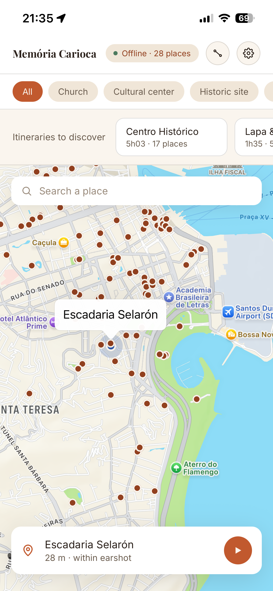
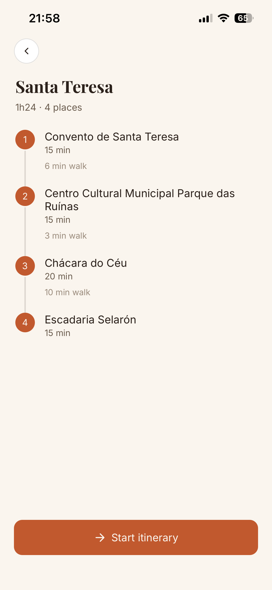
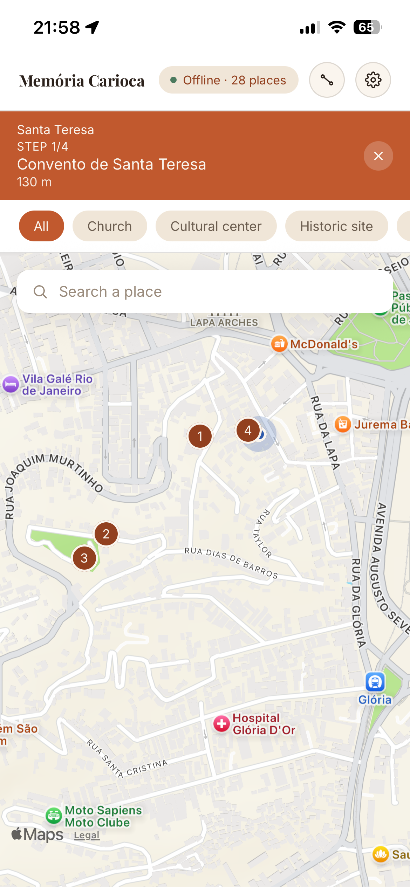
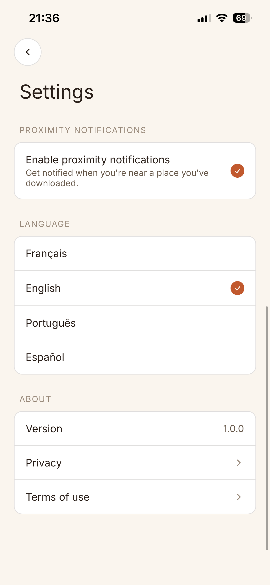

# Memória Carioca — Rio Audio Guide

A hands-free, multilingual (EN/FR/PT/ES) geolocation-triggered audio guide for Rio de Janeiro's
cultural and heritage sites. Real, sourced, verified content (grounded in Wikidata/Wikipedia/Overture,
checked by an anti-hallucination pass) — not AI-invented history.

**Stack**: React Native (Expo) · Go (hexagonal architecture + DDD) · PostgreSQL/PostGIS · AWS (EC2, RDS, S3) provisioned with Terraform · RabbitMQ · Redis · Anthropic Claude (AI itineraries, place assistant) · OpenAI & Google Cloud TTS/Whisper (narration + synced captions) · Next.js (landing page)

See [`mission.md`](mission.md) for the full vision, scope, and current project status.

## App features

<!-- Screenshots added as they're captured -- see docs/superpowers/specs/2026-10-18-live-testing-session-status.md -->

| | |
|---|---|
| **Curated map with nearby places** — search, filter by category, multilingual labels. |  |
| **Hands-free, location-triggered narration** — synced, karaoke-style captions highlight the sentence being read as it plays. |  |
| **Free-reading mode** — the full narration text, for anyone who'd rather read than follow along word-by-word. |  |
| **Guided pilot itineraries** — hand-curated routes (Centro Histórico, Lapa & Arcos, Santa Teresa) with real verified stops. |  |
| **Live itinerary progress** — numbered map pins and a progress banner while a route is active. |  |
| **AI-generated custom itineraries** — describe your time/interests, get a route built only from verified places in the guide (every stop is a real, grounded place; a hallucinated place is architecturally impossible, see [`backend/README.md`](backend/README.md)). |  |
| **Ask a question about any place** — a grounded chat assistant answers using only the guide's own sourced content. |  |
| **Multilingual throughout** — EN/FR/PT/ES, UI and narration independently switchable. |  |

## Repository structure

A monorepo: backend, frontend, and the sourcing pipeline used to previously live on separate branches,
reviewed and merged independently — as of 2026-08-19 all three are merged into `master`, which is now
the single integration branch (see `CLAUDE.md` for the review/branching convention this project follows
going forward — short-lived branches per change, not per subsystem).

- **`backend/`** — the Go backend. Hexagonal architecture (ports & adapters) + Domain-Driven Design,
  PostgreSQL/PostGIS, RabbitMQ (TTS job queue), S3, voice generation via OpenAI and Google Cloud TTS
  (with OpenAI Whisper producing the synced-caption timing). Has its own [README](backend/README.md)
  with the full architecture trace and setup/run instructions.
- **`web/`** — the Next.js landing page. Makes no calls to the Go backend, deployed independently of
  its AWS infrastructure — not a static export though (it uses Next.js Middleware for locale routing,
  which needs a real Node.js runtime, `output: "standalone"`). Has its own [README](web/README.md).
- **`mobile/`** — the React Native (Expo) app, iOS first. Talks to the real backend
  (`EXPO_PUBLIC_API_BASE_URL` in a local `.env`, same rule — never commit real values).
- **`pipeline/`** — the Python sourcing pipeline (Overture Maps, Wikidata, feiras livres registry,
  deduplication — `pipeline/sourcing/`, a tested package) and the content curation scripts (grounding,
  narration, translation, anti-hallucination checks — `pipeline/curation/`, ad-hoc, not a tested
  package). Produces the CSVs `backend/cmd/import` consumes; has no runtime relationship to
  backend/frontend beyond that one-time import.

## Why Go for the backend, why Python for the pipeline

**Go, hexagonal + DDD, backend**: the domain has real invariants — no publish without human review, no
language variant without its generated audio, conservative dedup (a false merge already dropped a real
place once during sourcing, the hard way). Static typing catches missed state-transition bugs at compile
time; goroutines/channels are a direct fit for an API and a RabbitMQ worker running concurrently. Kafka,
MongoDB, and Redis were each proposed and cut — no measured need, only "it's on a skills list," not a
real reason. Full writeup:
[`docs/superpowers/specs/2026-08-04-backend-stack-decision.md`](docs/superpowers/specs/2026-08-04-backend-stack-decision.md).

**Python, sourcing/curation pipeline**: never formally decided, just the obvious fit — one-off batch work
(Wikidata SPARQL queries, scraping, CSV wrangling, geocoding), run by hand, human-checked at every
checkpoint, never a long-running service. Nothing here is concurrent or needs invariants enforced over
time, so Go's actual strengths don't apply. `pipeline/sourcing/` is the one tested package;
`pipeline/curation/` is deliberately ad-hoc, run manually.

## Where to find more

- [`mission.md`](mission.md) — the living, always-current source of truth for scope and status. Edited
  in place as the project moves, unlike the dated documents below.
- [`docs/superpowers/specs/`](docs/superpowers/specs/) — dated decision/research documents (design
  doc, roadmap updates, stack decisions, product PRD), append-only history, never edited after the
  fact.
- [`docs/superpowers/plans/`](docs/superpowers/plans/) — per-feature TDD implementation plans.
- [`CLAUDE.md`](CLAUDE.md) — engineering conventions and repo structure, for anyone (human or AI)
  working in this codebase.
